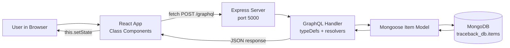

# TraceBack – Lost & Found Intelligence Platform
### PROJECT EXPLANATION

This document explains the **actual implemented code** of TraceBack. All code snippets are copied directly from the project source files.

---

## 1. Project Title

**TraceBack – Lost & Found Intelligence Platform**
(MCA Individual Micro-Project – Full Stack Web Development using MERN)

## 2. Project Objective

To build a web-based Lost and Found system where users can:

- report lost items,
- report found items,
- browse, search and filter all reports,
- see possible matches between lost and found reports.

## 3. Problem Statement

In colleges, hostels and public places, people lose things like ID cards, wallets, phones, keys and books. Today they depend on WhatsApp groups, notice boards and word of mouth. The information is scattered, and it is hard to find the report that matches your item.

TraceBack gives one central place to report, search and match lost and found items.

## 4. Technologies Used

| Layer | Technology | Why it is used |
|---|---|---|
| Frontend | React 18 (class components, JSX) | Builds the user interface from components |
| Styling | CSS3 | Layout, colours, responsive design |
| Backend | Node.js + Express.js | Runs the server (CommonJS `require`) |
| API | GraphQL (`graphql`, `graphql-http`) | One endpoint where the client asks for exactly the data it needs |
| Database | MongoDB + Mongoose | Stores the reports permanently |
| Communication | Native `fetch()` | Sends GraphQL requests from React to the server |
| Dev tool | Vite | Only starts/builds the React app (not part of the logic) |

Not used (as per project rules): Apollo Client, Redux, React Hooks, TypeScript, Tailwind, Bootstrap, authentication, external AI APIs.

## 5. Application Architecture

TraceBack has three parts:

1. **Client (React, port 3000)** – shows the screen and handles user events.
2. **Server (Express + GraphQL, port 5000)** – receives GraphQL requests and runs resolver functions.
3. **Database (MongoDB, port 27017)** – stores data in database `traceback_db`, collection `items`.

Data path: **React → fetch() → GraphQL endpoint → resolver → Mongoose → MongoDB → back to React → `this.setState()` → screen updates.**

## 6. Architecture Diagram



## 7. Project Folder Structure

```
TraceBack/
├── client/
│   ├── public/favicon.svg
│   ├── index.html
│   ├── vite.config.js
│   ├── package.json
│   └── src/
│       ├── components/
│       │   ├── Navbar.jsx
│       │   ├── Dashboard.jsx
│       │   ├── ItemForm.jsx
│       │   ├── ItemCard.jsx
│       │   ├── ItemList.jsx
│       │   ├── SearchBar.jsx
│       │   ├── FilterButtons.jsx
│       │   ├── MatchResults.jsx
│       │   └── Footer.jsx
│       ├── services/graphql.js
│       ├── App.jsx
│       ├── App.css
│       ├── index.css
│       └── main.jsx
├── server/
│   ├── config/database.js
│   ├── models/Item.js
│   ├── graphql/typeDefs.js
│   ├── graphql/resolvers.js
│   ├── server.js
│   ├── package.json
│   └── .env.example
├── PROJECT_EXPLANATION.md
└── README.md
```

## 8. Application Workflow

Example: the user reports a lost item.

1. The user types in the form. Each key press fires **onChange**, and `ItemForm` saves the text in `this.state`.
2. The user clicks the submit button. **onSubmit** runs `handleSubmit`, which calls `event.preventDefault()` and validates the fields.
3. If valid, `ItemForm` calls the callback `this.props.onSubmit(data)` (child → parent).
4. `App.handleReport` calls `reportLostItem()` from `services/graphql.js`.
5. That function sends a `fetch()` POST with the `reportLostItem` mutation to `http://localhost:5000/graphql`.
6. Express passes the request to the GraphQL handler, which runs the `reportLostItem` resolver.
7. The resolver calls `Item.create(...)`, and Mongoose saves the document in MongoDB.
8. The new item travels back as JSON. `App` adds it to `this.state.items` with `this.setState()`.
9. React re-renders: the new card appears and the dashboard counts change.

## 9. Explanation of Every React Component

| Component | Type | What it does |
|---|---|---|
| `App.jsx` | Stateful | Main parent. Holds all shared state, calls the server, renders everything |
| `Navbar.jsx` | Stateless | Shows the brand and navigation buttons; tells parent which section was clicked |
| `Dashboard.jsx` | Stateless | Shows the tagline and counts (total, lost, found) calculated from the `items` prop |
| `ItemForm.jsx` | Stateful | Lost/Found form. Keeps field values and validation errors. Used twice (`formType="LOST"` and `"FOUND"`) |
| `ItemCard.jsx` | Stateless | Shows one item (image, name, category, description, location, date, badge) and a Delete button |
| `ItemList.jsx` | Stateless | Loops over `items` and renders one `ItemCard` for each; shows the empty message when the list is empty |
| `SearchBar.jsx` | Stateless | Search input + Search button; sends text and click events to the parent |
| `FilterButtons.jsx` | Stateless | All / Lost / Found buttons; tells the parent which one was clicked |
| `MatchResults.jsx` | Stateless | Shows each lost report next to its possible found report with the match score |
| `Footer.jsx` | Stateless | Project name and short description |

All components are **React class components** with `render()`. No hooks are used.

## 10. Stateful and Stateless Components

- **Stateful component** = has `this.state`. It remembers data and re-renders when `this.setState()` is called. In TraceBack: `App` and `ItemForm`.
- **Stateless component** = no `this.state`. It only shows what it receives in `this.props`. In TraceBack: `Navbar`, `Dashboard`, `ItemCard`, `ItemList`, `SearchBar`, `FilterButtons`, `MatchResults`, `Footer`.

`ItemCard` is a good stateless example. It has no `this.state`. Its `render()` only reads `this.props.item` (the item sent by its parent):

```jsx
// client/src/components/ItemCard.jsx
    const item = this.props.item;
    const isLost = item.status === "LOST";
```

## 11. State Management using this.state and this.setState()

All shared data is stored in the state of `App`:

```jsx
// client/src/App.jsx
  constructor(props) {
    super(props);
    this.state = {
      items: [],
      loading: true,
      error: "",
      successMessage: "",
      searchTerm: "",
      searchResults: null, // null means "no search is active"
      selectedFilter: "ALL",
      matchingResults: [],
      matchesLoading: false,
      matchesChecked: false,
      activeSection: "dashboard"
    };

    this.successTimer = null;

    this.loadItems = this.loadItems.bind(this);
    this.handleReport = this.handleReport.bind(this);
    this.handleDelete = this.handleDelete.bind(this);
    this.handleSearchChange = this.handleSearchChange.bind(this);
    this.handleSearch = this.handleSearch.bind(this);
    this.handleClearSearch = this.handleClearSearch.bind(this);
    this.handleFilterChange = this.handleFilterChange.bind(this);
    this.handleFindMatches = this.handleFindMatches.bind(this);
    this.handleNavigate = this.handleNavigate.bind(this);
    this.dismissError = this.dismissError.bind(this);
  }
```

| State | Meaning |
|---|---|
| `items` | All reports loaded from MongoDB |
| `loading` | `true` while data is being fetched (shows the spinner) |
| `error` | Error message to show to the user |
| `successMessage` | Green message after a successful action |
| `searchTerm` | Text typed in the search box |
| `searchResults` | Result of the search (`null` means no search is active) |
| `selectedFilter` | `"ALL"`, `"LOST"` or `"FOUND"` |
| `matchingResults` | List of `{ lostItem, foundItem, score }` |
| `matchesLoading`, `matchesChecked` | Control the loading text and the "no matches" message |
| `activeSection` | Highlights the current navbar button |

**State is never changed directly.** A new array is created with spread, `filter()` or `map()`, and then `this.setState()` is called. Example from `handleDelete`:

```jsx
// client/src/App.jsx
  async handleDelete(id) {
    try {
      await deleteItem(id);

      this.setState({
        items: this.state.items.filter((item) => item.id !== id),
        searchResults:
          this.state.searchResults === null
            ? null
            : this.state.searchResults.filter((item) => item.id !== id),
        matchingResults: this.state.matchingResults.filter(
          (result) => result.lostItem.id !== id && result.foundItem.id !== id
        ),
        error: ""
      });
      this.showSuccess("Item deleted successfully.");
    } catch (error) {
      this.setState({ error: error.message });
    }
  }
```

`filter()` creates a new array without the deleted item. React sees the new state and re-renders.

## 12. Props and Parent-Child Communication

**Props** are values passed from a parent to a child. They are read-only.

Parent → child examples (from `App.render()`):

- `<Dashboard items={this.state.items} />`
- `<ItemList items={...} emptyMessage={...} onDelete={this.handleDelete} />`
- `<FilterButtons selectedFilter={this.state.selectedFilter} onFilterChange={this.handleFilterChange} />`

`ItemForm` uses the prop `formType` to know if it is a lost form or a found form:

```jsx
// client/src/components/ItemForm.jsx
    const isLost = this.props.formType === "LOST";
    const word = isLost ? "Lost" : "Found";
    const formClass = isLost ? "form-card form-lost" : "form-card form-found";
    const idPrefix = isLost ? "lost-" : "found-";
```

**Child → parent communication** is done with **callback functions** passed as props. The child calls the function, and the parent's function runs and changes the parent's state. See the next section.

## 13. Lifting State Up

The search text and the selected filter are needed by `App` (to decide which items to show), so they are stored in `App`, not in `SearchBar` or `FilterButtons`. The children only display the value and report changes.

`SearchBar` receives the value and a callback:

```jsx
// client/src/components/SearchBar.jsx
        <input
          type="text"
          placeholder="Search by item name..."
          value={this.props.searchTerm}
          onChange={(event) => this.props.onSearchChange(event.target.value)}
          onKeyDown={(event) => {
            if (event.key === "Enter") this.props.onSearch();
          }}
        />
```

`App` owns the state and the handler:

```jsx
// client/src/App.jsx
  handleSearchChange(value) {
    this.setState({ searchTerm: value });
  }
```

Flow: user types → `onChange` in `SearchBar` → calls `this.props.onSearchChange(text)` → `App.handleSearchChange` → `this.setState({ searchTerm })` → `App` re-renders and passes the new value back down as `searchTerm`.

The same idea is used for the filter (`onFilterChange`), delete (`onDelete`) and navigation (`onNavigate`). `ItemList` also passes `onDelete` down to `ItemCard` (two levels).

## 14. React Event Handling

| Event | Where | What it does |
|---|---|---|
| `onChange` | `ItemForm` inputs, select, textarea | Updates the form state |
| `onChange` | `SearchBar` input | Updates `searchTerm` in the parent |
| `onSubmit` | `ItemForm` `<form>` | Validates and saves the report (`event.preventDefault()`) |
| `onClick` | Search button | Runs the GraphQL search |
| `onClick` | Delete button | Asks for confirmation, then deletes |
| `onClick` | Filter buttons | Changes `selectedFilter` |
| `onClick` | Navbar buttons | Scrolls to a section and highlights it |
| `onClick` | Find Matches button | Loads possible matches |
| `onKeyDown` | Search input | Pressing Enter also searches |

One `onChange` handler works for all form fields because every input has a `name` attribute:

```jsx
// client/src/components/ItemForm.jsx
  handleChange(event) {
    const field = event.target.name;
    const value = event.target.value;
    this.setState({ [field]: value });
  }
```

Form submit with validation:

```jsx
// client/src/components/ItemForm.jsx
  async handleSubmit(event) {
    event.preventDefault();

    const errors = this.validate();
    this.setState({ errors: errors });
    if (Object.keys(errors).length > 0) {
      return;
    }

    this.setState({ submitting: true });

    const success = await this.props.onSubmit({
      name: this.state.name.trim(),
      category: this.state.category,
      description: this.state.description.trim(),
      location: this.state.location.trim(),
      date: this.state.date,
      imageUrl: this.state.imageUrl.trim()
    });

    if (success) {
      // Clear the form after a successful save.
      this.setState({
        name: "",
        category: "",
        description: "",
        location: "",
        date: "",
        imageUrl: "",
        errors: {},
        submitting: false
      });
    } else {
      this.setState({ submitting: false });
    }
  }
```

## 15. GraphQL Schema Explanation

GraphQL has **types** (shape of data), **queries** (read data) and **mutations** (change data). The full schema is in `server/graphql/typeDefs.js`:

```js
// server/graphql/typeDefs.js
const typeDefs = `
  type Item {
    id: ID!
    name: String!
    category: String!
    description: String
    location: String!
    date: String
    imageUrl: String
    status: String!
    createdAt: String
    matchScore: Int
  }

  type Query {
    getAllItems: [Item!]!
    getItem(id: ID!): Item
    searchItems(name: String!): [Item!]!
    getItemsByStatus(status: String!): [Item!]!
    getPossibleMatches(itemId: ID!): [Item!]!
  }

  type Mutation {
    reportLostItem(
      name: String!
      category: String!
      description: String
      location: String!
      date: String
      imageUrl: String
    ): Item!

    reportFoundItem(
      name: String!
      category: String!
      description: String
      location: String!
      date: String
      imageUrl: String
    ): Item!

    deleteItem(id: ID!): Boolean!
  }
`;
```

- `Item` matches the fields of the MongoDB document. `!` means the field cannot be null.
- `matchScore` is an extra optional field (not in the starting schema). It is filled only by `getPossibleMatches`, so the client can show the percentage.
- The server builds the schema with `buildSchema(typeDefs)` in `server.js`.

## 16. GraphQL Queries

| Query | Purpose |
|---|---|
| `getAllItems` | All reports, newest first |
| `getItem(id)` | One report by id |
| `searchItems(name)` | Reports whose name contains the text (case-insensitive) |
| `getItemsByStatus(status)` | Only `LOST` or only `FOUND` reports |
| `getPossibleMatches(itemId)` | Reports of the opposite status that match this report (with `matchScore`) |

The queries as sent from React (`client/src/services/graphql.js`), written with variables:

```js
// client/src/services/graphql.js
export async function searchItems(name) {
  const query = `
    query SearchItems($name: String!) {
      searchItems(name: $name) {
        ${ITEM_FIELDS}
      }
    }
  `;
  const data = await sendRequest(query, { name: name });
  return data.searchItems;
}
```

```js
// client/src/services/graphql.js
export async function fetchPossibleMatches(itemId) {
  const query = `
    query PossibleMatches($itemId: ID!) {
      getPossibleMatches(itemId: $itemId) {
        ${ITEM_FIELDS}
        matchScore
      }
    }
  `;
  const data = await sendRequest(query, { itemId: itemId });
  return data.getPossibleMatches;
}
```

## 17. GraphQL Mutations

| Mutation | Purpose |
|---|---|
| `reportLostItem(...)` | Saves a new item with status `LOST` and returns it |
| `reportFoundItem(...)` | Saves a new item with status `FOUND` and returns it |
| `deleteItem(id)` | Deletes the item and returns `true` |

As sent from React:

```js
// client/src/services/graphql.js
export async function reportLostItem(itemData) {
  const mutation = `
    mutation ReportLost(
      $name: String!
      $category: String!
      $description: String
      $location: String!
      $date: String
      $imageUrl: String
    ) {
      reportLostItem(
        name: $name
        category: $category
        description: $description
        location: $location
        date: $date
        imageUrl: $imageUrl
      ) {
        ${ITEM_FIELDS}
      }
    }
  `;
  const data = await sendRequest(mutation, itemData);
  return data.reportLostItem;
}
```

```js
// client/src/services/graphql.js
export async function deleteItem(id) {
  const mutation = `
    mutation DeleteItem($id: ID!) {
      deleteItem(id: $id)
    }
  `;
  const data = await sendRequest(mutation, { id: id });
  return data.deleteItem;
}
```

## 18. Resolver Functions

A resolver is the function that runs when a query or mutation is called. Here each resolver is a property of the `resolvers` object, and every one talks to MongoDB through the `Item` model (no fake data).

Reading data:

```js
// server/graphql/resolvers.js
  getAllItems: async () => {
    const items = await Item.find().sort({ createdAt: -1 });
    return items.map((item) => formatItem(item));
  },
```

```js
// server/graphql/resolvers.js
  searchItems: async ({ name }) => {
    // Escape special characters so the text is searched as normal text.
    const safeName = name.trim().replace(/[.*+?^${}()|[\]\\]/g, "\\$&");
    const items = await Item.find({ name: { $regex: safeName, $options: "i" } }).sort({ createdAt: -1 });
    return items.map((item) => formatItem(item));
  },
```

Creating data (shared by lost and found):

```js
// server/graphql/resolvers.js
async function createItem(args, status) {
  const item = await Item.create({
    name: args.name,
    category: args.category,
    description: args.description,
    location: args.location,
    date: args.date ? new Date(args.date) : undefined,
    imageUrl: args.imageUrl,
    status: status
  });
  return formatItem(item);
}
```

```js
// server/graphql/resolvers.js
  reportLostItem: async (args) => createItem(args, "LOST"),

  reportFoundItem: async (args) => createItem(args, "FOUND"),
```

Deleting data:

```js
// server/graphql/resolvers.js
  deleteItem: async ({ id }) => {
    checkId(id);
    const deleted = await Item.findByIdAndDelete(id);
    if (!deleted) {
      throw new Error("Item not found");
    }
    return true;
  }
```

Error handling: if something is wrong (invalid id, item not found, invalid category) the resolver throws an `Error`. GraphQL puts its message in the `errors` array of the response, and the frontend shows it to the user.

The helper `formatItem` converts a MongoDB document into the GraphQL `Item` shape (for example `_id` becomes `id`):

```js
// server/graphql/resolvers.js
function formatItem(doc, matchScore) {
  return {
    id: doc._id.toString(),
    name: doc.name,
    category: doc.category,
    description: doc.description,
    location: doc.location,
    date: doc.date ? doc.date.toISOString().slice(0, 10) : null,
    imageUrl: doc.imageUrl,
    status: doc.status,
    createdAt: doc.createdAt ? doc.createdAt.toISOString() : null,
    matchScore: matchScore === undefined ? null : matchScore
  };
}
```

## 19. Fetch API Integration

All server communication is in one file: `client/src/services/graphql.js`. The function `sendRequest` is used by every other function:

```js
// client/src/services/graphql.js
async function sendRequest(query, variables) {
  let response;

  try {
    response = await fetch(GRAPHQL_URL, {
      method: "POST",
      headers: { "Content-Type": "application/json" },
      body: JSON.stringify({ query: query, variables: variables })
    });
  } catch (networkError) {
    throw new Error("Cannot reach the server. Make sure the backend is running on port 5000.");
  }

  const result = await response.json();

  // Check for GraphQL errors before using result.data.
  if (result.errors && result.errors.length > 0) {
    throw new Error(result.errors[0].message);
  }

  return result.data;
}
```

Important points:

1. `fetch()` sends a **POST** request with the query and the variables as JSON.
2. If the server is not reachable, a clear message is thrown.
3. GraphQL errors are checked **before** using `result.data`.
4. Variables (`$id`, `$name`, ...) are used instead of joining strings.

Functions available in the service file: `fetchAllItems`, `fetchItem`, `searchItems`, `fetchItemsByStatus`, `reportLostItem`, `reportFoundItem`, `deleteItem`, `fetchPossibleMatches`.

The initial data is loaded in `componentDidMount`:

```jsx
// client/src/App.jsx
  componentDidMount() {
    this.loadItems();
  }
```

```jsx
// client/src/App.jsx
  async loadItems() {
    this.setState({ loading: true, error: "" });
    try {
      const items = await fetchAllItems();
      this.setState({ items: items, loading: false });
    } catch (error) {
      this.setState({ loading: false, error: error.message });
    }
  }
```

## 20. MongoDB Database Structure

- Database: `traceback_db`
- Collection: `items`
- The connection string comes from `MONGODB_URI` in `server/.env` (never written in the React code).

Mongoose model (`server/models/Item.js`):

```js
// server/models/Item.js
const itemSchema = new mongoose.Schema({
  name: {
    type: String,
    required: [true, "Item name is required"],
    trim: true,
    maxlength: [100, "Item name must be 100 characters or less"]
  },
  category: {
    type: String,
    required: [true, "Category is required"],
    enum: { values: CATEGORIES, message: "Invalid category" }
  },
  description: {
    type: String,
    trim: true,
    default: ""
  },
  location: {
    type: String,
    required: [true, "Location is required"],
    trim: true
  },
  date: {
    type: Date
  },
  imageUrl: {
    type: String,
    trim: true,
    default: ""
  },
  status: {
    type: String,
    required: true,
    enum: { values: ["LOST", "FOUND"], message: "Status must be LOST or FOUND" }
  },
  createdAt: {
    type: Date,
    default: Date.now
  }
});
```

| Field | Type | Notes |
|---|---|---|
| `_id` | ObjectId | Created automatically by MongoDB |
| `name` | String | Required, max 100 characters |
| `category` | String | Required, one of the 7 categories |
| `description` | String | Optional on the server (the form requires it) |
| `location` | String | Required |
| `date` | Date | Date lost / found |
| `imageUrl` | String | Optional |
| `status` | String | `LOST` or `FOUND` |
| `createdAt` | Date | Set automatically |

The model is linked to the collection name here:

```js
// server/models/Item.js
const Item = mongoose.model("Item", itemSchema, "items");
```

Database connection:

```js
// server/config/database.js
async function connectDatabase() {
  const uri = process.env.MONGODB_URI;

  if (!uri) {
    throw new Error("MONGODB_URI is missing. Create server/.env from server/.env.example");
  }

  await mongoose.connect(uri, { serverSelectionTimeoutMS: 5000 });
  console.log("MongoDB connected: " + mongoose.connection.name);
}
```

## 21. Smart Matching Algorithm

It is a simple rule-based algorithm written in plain JavaScript (no AI, no machine learning). It lives in `server/graphql/resolvers.js`.

| Attribute | Weight | Rule |
|---|---|---|
| Same category | 40% | Equal ignoring upper/lower case |
| Similar item name | 35% | Equal = full, one name inside the other = 80%, otherwise share of common words |
| Same location | 25% | Equal ignoring upper/lower case |

Name similarity:

```js
// server/graphql/resolvers.js
function nameSimilarity(nameA, nameB) {
  const a = clean(nameA);
  const b = clean(nameB);

  if (a === "" || b === "") return 0;
  if (a === b) return 1;
  if (a.includes(b) || b.includes(a)) return 0.8; // partial match

  // Count how many words are common in both names.
  const wordsA = a.split(/\s+/);
  const wordsB = b.split(/\s+/);
  const commonWords = wordsA.filter((word) => wordsB.includes(word)).length;
  return commonWords / Math.max(wordsA.length, wordsB.length);
}
```

Total score:

```js
// server/graphql/resolvers.js
function calculateMatchScore(itemA, itemB) {
  let score = 0;

  if (clean(itemA.category) === clean(itemB.category)) {
    score += CATEGORY_WEIGHT;
  }

  score += nameSimilarity(itemA.name, itemB.name) * NAME_WEIGHT;

  if (clean(itemA.location) === clean(itemB.location)) {
    score += LOCATION_WEIGHT;
  }

  return Math.round(score);
}
```

Finding matches for one report:

```js
// server/graphql/resolvers.js
  getPossibleMatches: async ({ itemId }) => {
    checkId(itemId);
    const item = await Item.findById(itemId);
    if (!item) {
      throw new Error("Item not found");
    }

    // Compare only with reports of the opposite status.
    const oppositeStatus = item.status === "LOST" ? "FOUND" : "LOST";
    const candidates = await Item.find({ status: oppositeStatus });

    return candidates
      .map((candidate) => ({ candidate: candidate, score: calculateMatchScore(item, candidate) }))
      .filter((result) => result.score >= MIN_MATCH_SCORE)
      .sort((a, b) => b.score - a.score)
      .map((result) => formatItem(result.candidate, result.score));
  },
```

Rules followed:

1. Only reports with the **opposite status** are compared (so an item is never matched with itself or with the same status).
2. Matches below **50%** are hidden (`MIN_MATCH_SCORE`). Without this limit, any two items of the same category (40%) would look like a match.
3. Results are sorted from highest to lowest score.

**Example 1 (100%)**

| | Lost report | Found report | Points |
|---|---|---|---|
| Name | Black Wallet | black wallet | 35 (same ignoring case) |
| Category | Wallet | Wallet | 40 |
| Location | NMAMIT Library | nmamit library | 25 |
| **Total** | | | **100%** |

**Example 2 (68%)**

| | Lost report | Found report | Points |
|---|---|---|---|
| Name | Black Wallet | Wallet | 28 ("wallet" is inside "black wallet" → 0.8 × 35) |
| Category | Wallet | Wallet | 40 |
| Location | NMAMIT Library | Canteen | 0 |
| **Total** | | | **68%** |

On the screen, `App.handleFindMatches` asks the server for the matches of every lost report and builds the list shown by `MatchResults`:

```jsx
// client/src/App.jsx
  async handleFindMatches() {
    this.setState({ matchesLoading: true, error: "" });

    try {
      const lostItems = this.state.items.filter((item) => item.status === "LOST");
      const matchLists = await Promise.all(lostItems.map((item) => fetchPossibleMatches(item.id)));

      const results = [];
      lostItems.forEach((lostItem, index) => {
        matchLists[index].forEach((foundItem) => {
          results.push({ lostItem: lostItem, foundItem: foundItem, score: foundItem.matchScore });
        });
      });
      results.sort((a, b) => b.score - a.score);

      this.setState({ matchingResults: results, matchesLoading: false, matchesChecked: true });
    } catch (error) {
      this.setState({ matchesLoading: false, error: error.message });
    }
  }
```

## 22. Explanation of Important Source Code

**server.js** – starts Express, adds CORS, creates the `/graphql` endpoint, connects to MongoDB and then starts listening:

```js
// server/server.js
const schema = buildSchema(typeDefs);

// GraphQL endpoint: POST http://localhost:5000/graphql
```

```js
// server/server.js
connectDatabase()
  .then(() => {
    app.listen(PORT, () => {
      console.log("Server running at http://localhost:" + PORT);
      console.log("GraphQL endpoint: http://localhost:" + PORT + "/graphql");
    });
  })
  .catch((error) => {
    console.error("Could not connect to MongoDB: " + error.message);
    console.error("Start MongoDB or check MONGODB_URI in server/.env");
    process.exit(1);
  });
```

**App.handleReport** – called by `ItemForm` through a callback; saves the item and updates the state without changing the old array:

```jsx
// client/src/App.jsx
  async handleReport(formType, itemData) {
    try {
      const newItem =
        formType === "LOST" ? await reportLostItem(itemData) : await reportFoundItem(itemData);

      // Create a new array instead of changing the old one.
      this.setState({
        items: [newItem, ...this.state.items],
        error: "",
        searchTerm: "",
        searchResults: null,
        matchingResults: [],
        matchesChecked: false
      });
      this.showSuccess(
        (formType === "LOST" ? "Lost" : "Found") + ' report "' + newItem.name + '" saved successfully.'
      );
      return true;
    } catch (error) {
      this.setState({ error: error.message });
      return false;
    }
  }
```

**App.getVisibleItems** – combines search and filter to decide what is shown:

```jsx
// client/src/App.jsx
  getVisibleItems() {
    const source = this.state.searchResults !== null ? this.state.searchResults : this.state.items;

    if (this.state.selectedFilter === "ALL") {
      return source;
    }
    return source.filter((item) => item.status === this.state.selectedFilter);
  }
```

**ItemCard delete click** – asks for confirmation before calling the parent's `onDelete` callback:

```jsx
// client/src/components/ItemCard.jsx
  handleDeleteClick(item) {
    if (window.confirm('Delete the report "' + item.name + '"? This cannot be undone.')) {
      this.props.onDelete(item.id);
    }
  }
```

## 23. Application Functionalities

| # | Functionality | How it works |
|---|---|---|
| A | Report lost item | Form → validation → `reportLostItem` mutation → MongoDB → card appears |
| B | Report found item | Same with `reportFoundItem`; Found badge is green, Lost badge is orange |
| C | Display all items | `getAllItems` query in `componentDidMount` → card grid |
| D | Search | Type text, click Search → `searchItems` query; message when nothing is found |
| E | Filter | All / Lost / Found buttons change `selectedFilter` in state |
| F | Delete | Confirm → `deleteItem` mutation → item removed from MongoDB and from state |
| G | Smart matching | "Find Matches" → `getPossibleMatches` for each lost report → comparison cards with % |
| – | Dashboard | Total / lost / found counts calculated from `items` |
| – | Feedback | Loading spinner, error message with "Try again", success message, empty states |

**What was tested while building this project**

- All 8 GraphQL operations were tested with `curl` against a running server and a real MongoDB (create, read, search, filter by status, matching in both directions, delete, invalid id, invalid category, unknown item).
- Data was checked to stay in MongoDB after restarting the server.
- The React flow (load, validation errors, onChange, onSubmit, success message, dashboard counts, search with and without results, filters, matching percentages 100% and 68%, delete with confirmation, navbar click, and the error message when the server is off) was tested with an automated script that renders the real `App` component and uses the real server.
- The production build (`npm run build`) completes without errors.
- Not done: testing in real browsers and on a real phone, so the visual look and responsive layout should be checked by you (see section 25).

## 24. Installation and Execution Steps

The complete step-by-step commands (Node.js, MongoDB, `.env`, starting both servers) are in `README.md`. Short version:

```bash
# Terminal 1 – backend
cd server
npm install
cp .env.example .env
npm start

# Terminal 2 – frontend
cd client
npm install
npm start
```

Then open http://localhost:3000. The GraphQL endpoint is http://localhost:5000/graphql.

## 25. Application Screenshots

Screenshots were **not captured automatically**, and none are invented here. Please take these screenshots yourself and add them to this document or to your report:

1. Dashboard / hero section with the three counts.
2. Lost and Found report forms (also one with validation errors).
3. All Reports section with Lost and Found cards.
4. Search result and the "no items found" message.
5. Filter set to Lost Items.
6. Smart Matching section showing a 100% match.
7. Terminal showing `MongoDB connected: traceback_db`.
8. MongoDB data (`mongosh` → `use traceback_db` → `db.items.find()`) as proof of storage.

## 26. Conclusion

TraceBack shows a complete MERN application with a GraphQL API: React class components with state, props, callbacks and lifting state up, event handling with `onChange`, `onSubmit` and `onClick`, GraphQL queries and mutations through the native Fetch API, and data stored permanently in MongoDB. The smart matching feature is a simple weighted rule system that is easy to explain.

**Known limitations**

- No login, so anyone can delete any report (this is outside the project scope).
- The filter buttons filter the list already in React state. `getItemsByStatus` and `getItem` exist on the server and in the service file but are not used by a button.
- Matching uses exact location text, so "Library" and "NMAMIT Library" do not match.
- Images use an image URL only (no file upload).
- Matching compares every lost report with the found reports, which is fine for a small project but not designed for very large data.

---

## Extra: Short viva answers

- **Why class components?** The project rules require `constructor`, `this.state`, `this.setState()` and `componentDidMount()` instead of hooks.
- **Why GraphQL instead of REST?** One endpoint; the client asks for exactly the fields it needs.
- **Why fetch and not Apollo?** The project must show the native Fetch API. A GraphQL request is just a POST with JSON.
- **Where does data persist?** In MongoDB (`traceback_db.items`), not in React state.
- **What is lifting state up?** Moving shared state (search text, filter) to the nearest common parent (`App`) and passing it down with props and callbacks.
- **Why `event.preventDefault()`?** To stop the browser from reloading the page when the form is submitted.
- **Why is `key` used in `map()`?** React needs a unique key (the item `id`) to update the list correctly.
